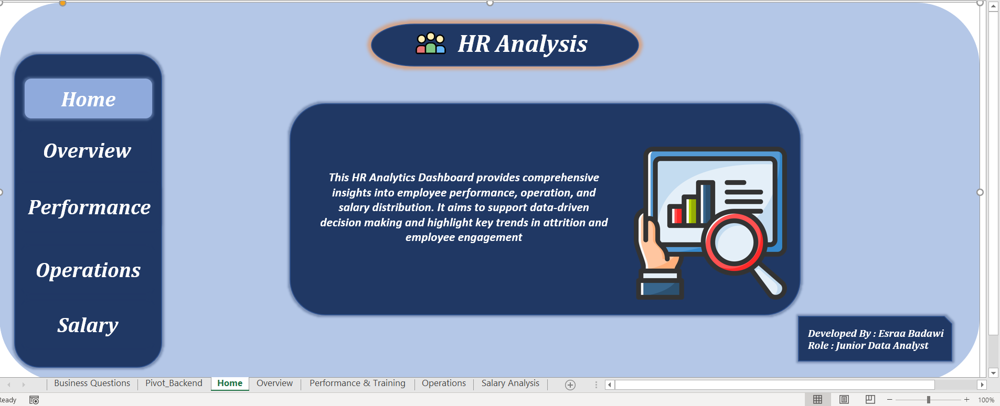
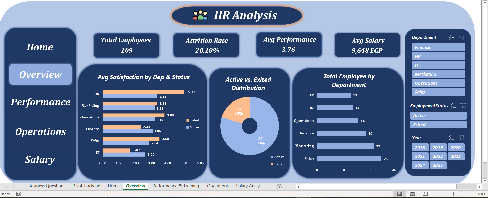
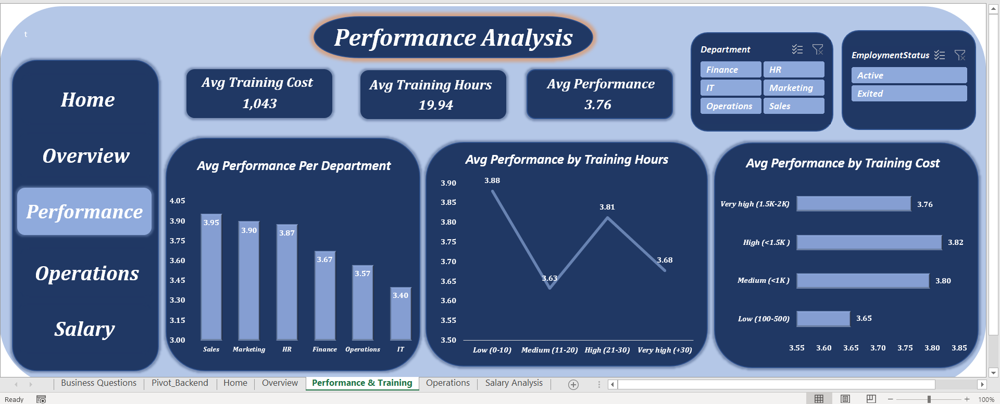
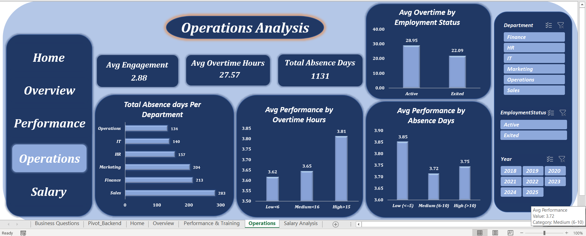
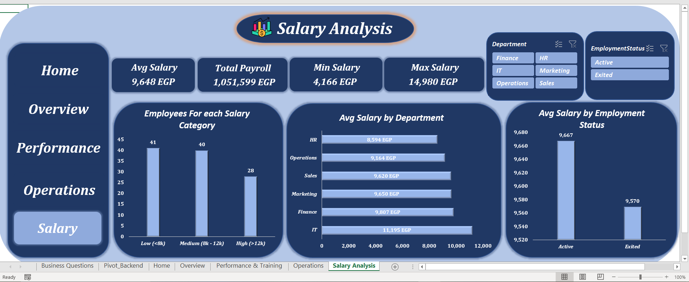

# HR Analytics & Employee Retention Dashboard

## Project Overview
An end-to-end HR Analytics Dashboard built entirely in Microsoft Excel. This project analyzes employee demographics, performance, operational metrics (absenteeism & overtime), and salary distribution to uncover actionable insights regarding employee attrition and retention strategies.

## Tech Stack & Skills Demonstrated
* **Data Extraction & Cleaning:** Power Query (ETL processes, conditional columns, handling missing values).
* **Data Modeling:** Power Pivot & Star Schema design (connecting fact and dimension tables).
* **Calculations:** DAX for creating robust measures (e.g., Total Payroll, Average Salary, Attrition Rate).
* **Data Visualization:** Interactive Excel Pivot Charts, Slicers, and UI/UX focused dashboard design.

## Key Business Questions Answered
* **Demographics:** What is the overall attrition rate and how is the workforce distributed?
* **Performance:** How does training cost and overtime impact employee performance scores?
* **Operations:** Which departments record the highest absence days and overtime hours?
* **Compensation:** What is the total payroll budget, and is there a salary gap between active and exited employees?

## Dashboard Previews

*(Note: Click on the images to view them in full resolution)*

### 1. Home / Objectives Page

### 2. General Overview & Demographics

### 3. Performance & Training Analysis

### 4. Operations Analysis

### 4. Salary Distribution & Payroll

## Key Insights
1. **Retention & Overtime:** Employees working excessive overtime hours tend to be the most active and retained, contrary to the assumption that overtime causes burnout-driven attrition.
2. **Performance Correlation:** There is a positive correlation between strategic training investments and overall employee performance scores.
3. **The IT Department Paradox:** The IT department receives the highest compensation company-wide. However, it reports the lowest job satisfaction and performance scores, indicating that financial compensation alone does not drive engagement or productivity

---
*Developed by Esraa - Junior Data Analyst | 2026*
